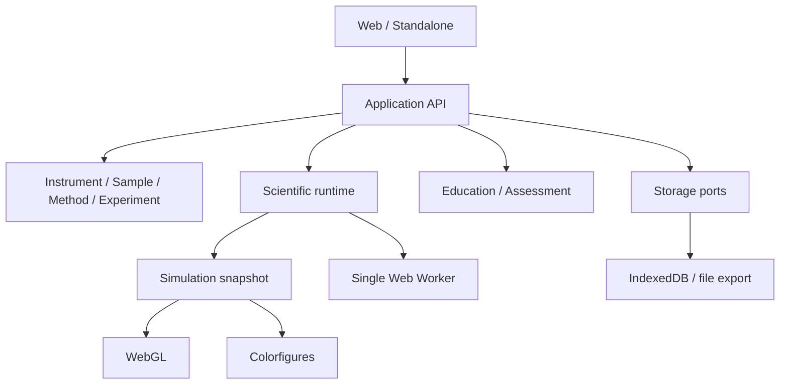

# Архитектура

Модульный монолит, DDD, Ports & Adapters. Цель Alpha: один завершённый LAB-008; остальные контракты расширения не требуют пустых пакетов. Базовый продукт Web и автономный HTML; Tauri, MCP, REST, LMS — последующие адаптеры. Без обязательного сервера, Docker, LLM или Python/Julia в runtime.

Контракты: Component (id, version, parent, geometry, ports, constraints, state machine); ScientificModel (parameters, units, validity, initialize, advance, output, provenance); Solver (capabilities, validate, run, cancel); Renderer (load, update snapshot, camera, mode, dispose); Experiment (snapshot method/config/parameter registry, seed streams, raw signal, events); Task (generate, evaluate, hints, transfer). JSON Schema + TypeScript + contract tests; schema migrations with fixtures. UI cannot mutate domain directly; commands validated in application layer. Events and snapshots suffice, no distributed CQRS. Scientific core independent of UI. Scientific time, frame time, wall time and acquisition sampling independent. Typed arrays for signal; transferable buffers, bounded queues, cancellation and backpressure. Persist input and outputs before report; import validates checksum, schema and limits. Offline hidden sample not secure exam secrecy.

Geometry: one canonical graph with mount anchors, port locations, constraints, LOD, physical dimensions and provenance. Adapters declare supported capabilities, never fake unsupported controls. Colorfigures requires actual source/license audit before reuse; use independent SVG adapter if permitted and explicitly disclose differences. Realistic PBR, see-through, exploded, clipping and micro scenes; statistical markers not molecular dynamics. Semantic identity preserved across scales. Validate support, routing, collisions, movement limits, 360° and rear/underside. No unlabelled exaggerated scale.

Target repository: apps/web, apps/standalone; packages/contracts, domain, application, scientific-core, simulation-runtime, laboratory-core, geometry-core, renderer-webgl, renderer-colorfigures, education-core, persistence, reporting as needed; domains/gas-chromatography; docs; tests; reference-solvers; evidence; skills; tools. Use pnpm lockfile, TypeScript, React/Vite, Three.js, Vitest, Playwright. Confirm actual versions and licenses at audit. Skills specify inputs, outputs, validation and artifacts. MCP calls same public application API, not direct storage.

8 GB RAM: one compute worker, one browser test worker, lazy scenes, disposal of GPU resources, economy 100k triangles, compressed/lower resolution assets, no mandatory external solver. Proposed budgets: app process tree attributable memory <=1 GiB, median FPS >=30, cold start <=5 s, interaction p95 <=150 ms, quick fixed benchmark <=3 s, standalone target <=20 MiB. Record OS, CPU, GPU, browser, workload and actual memory metric. Do not equate JS heap with total memory. Benchmark on physical target machine; CI proxy not substitute. Scientific outputs invariant under rendering quality and FPS.
