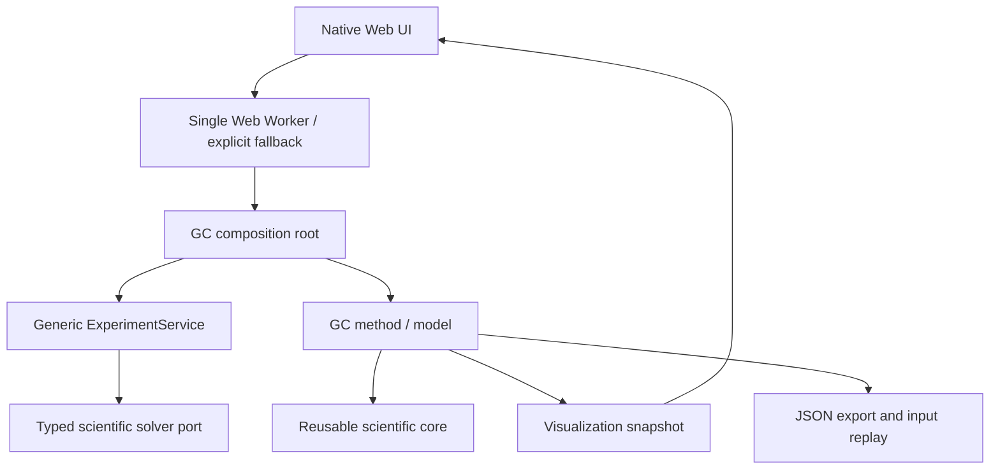

# MWP 0.0.1 — First Chromatogram

An executable preview of the approved GC baseline, not a release of Alpha 0.1. Parent repository: `3114fdb85772aac3770dfc728a5f7c669d3ad65d`. The initial tree contained the original README, MIT LICENSE and 14 baseline files; no application code or Colorfigures source. The accepted baseline is unchanged. The original root README is preserved and extended with links.

## Run

Download `releases/mwp-0.0.1/index.html` and open in a browser. It contains all scripts/styles, uses one Blob Worker, and has an explicit local computation fallback when Worker is unavailable. No network access or external data is required. File navigation itself was blocked by the test environment's Chromium enterprise policy; the HTML document was tested via Playwright `set_content` with network offline. Physical file:// acceptance on the target laptop is still open.

Development: Node 22.x (tested 22.16.0), TypeScript 5.8.3 on PATH (`npm install --global typescript@5.8.3` on a connected machine if missing), `npm ci`, `npm test`. `npm run build` creates `dist/index.html`. The version-checked compiler is an external tool; package lock has no npm dependencies. Optional tests: `python tests/reference.py` regenerates a standard-library numerical fixture; rerun `npm test` afterwards. `python tests/browser.py` requires Python Playwright and installed Chromium (`CHROMIUM_PATH` overrides the executable). It runs serially.

## Boundaries and ports

- `packages/contracts`: generic application reply and solver/experiment ports.
- `packages/application`: validated use case; concrete solver injected, no DOM or GC dependency.
- `packages/scientific-core`: reusable SI capillary, Gaussian and deterministic RNG functions.
- `domains/gas-chromatography`: GC method schema, synthetic parameter profile, model, visualization snapshot and composition root.
- `apps/web`: form, actual Worker adapter, Canvas signal, schematic SVG and result table; computation fallback uses the same service.
- `tools/build.cjs`: minimal reproducible compiler/bundler; no runtime dependencies.

The native DOM shell and dependency-free build are deliberate MWP staging choices for 8 GB RAM and the disconnected build environment, not a replacement of the target React/Vite/pnpm/Three.js architecture. No empty future packages are created. Migrate/add target adapters when they have real consumers, review at G0. This SVG is a schematic view, not Colorfigures and not an engineering 3D assembly. The real source/license of Colorfigures is absent.

## Functional scope

Edit a method → validate → compute pressure-dependent flow and residence time → compute three synthetic retained components and FID signal → inspect peaks and scrub the virtual replay timeline → export JSON → read method from JSON and recompute. Cancellation discards stale results, and errors are reported. Export stores input and calculated signal; import deliberately recomputes from versioned inputs, not a trusted measurement restoration. SHA-256 integrity, data migration, timestamped audit, storage ports and IndexedDB are not yet implemented. Core result arrays are frozen; structured cloning across Worker boundaries does not preserve frozen objects. UI owns its result snapshot. No secure exam claims.

## Next

G0 remains OPEN: complete scope conflict reconciliation, source/license audit, complete P0 traceability, physical target checks and human acceptance. G1 remains OPEN: network/EPC, thermal nodes, programmed retention, independent Julia/ODE reference, verified dispersion, richer parameter provenance. G2–G7 remain OPEN. No backlog task is marked DONE by this preview. See `model-passport.md`, `traceability.csv`, `agent-delivery-review.md`, and evidence logs.
